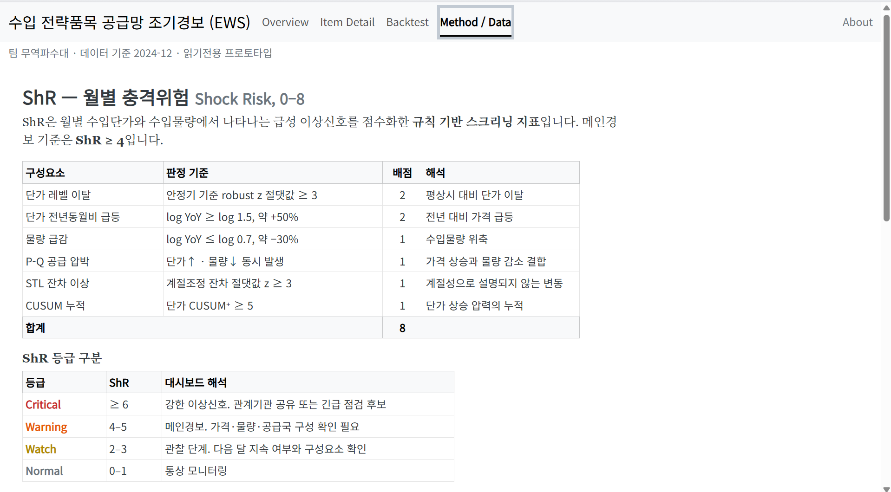
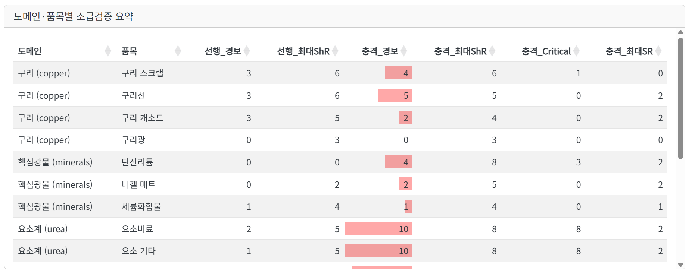

# 공급망 조기경보체계 | 위험지표 설계 및 검증

[상세 포트폴리오](https://app.notion.com/p/3fd6458e68be811b8291ca65212f3031?pvs=204) · [프로필](https://github.com/donghwan-analytics)


**전략자원의 공급망 위험을 지표화하고, 점검 우선순위와 위험 원인을 설명하는 조기경보체계를 설계했습니다.**
16개 전략품목 · 15,243개 국가–월 거래 레코드 · 2015–2024년

**2026 제1회 무역통계 활용·분석 경진대회 / 무역파수대 / 팀장**
## 프로젝트 개요
관세청 무역자료로 전략자원 공급망의 이상징후를 모니터링하는 체계를 설계했습니다. 공급국 집중과 단기 가격·물량 충격을 별도로 표시하고, 요소수 위기 구간을 구리 비교군과 대조했습니다. 경보가 발생했다는 사실만으로 성과를 판단하지 않고, **경보 강도·지속기간·원인·자료 신뢰도**를 함께 읽도록 분석을 개선했습니다.
## 담당 업무 및 협업 범위
- **문제 정의:** 수입액 변화의 설명에서 월별 위험 점검과 과거 위기 검증으로 분석 목표를 구체화했습니다.
- **방법 선택:** 통계적 품질관리에서 학습한 CUSUM의 활용을 제안하고, 단기 충격과 구조적 취약성을 분리하는 분석 방향을 정리했습니다.
- **검증:** 팀원 분석 이후 별도 검증 코드로 임계값 민감도, 구성요소 기여도, 지표 제거 실험과 기존 점수 비교를 점검했습니다.
- **결과 통합:** 비교군·기준선 분석을 해석하고 보고서와 제출자료 구성을 조율했습니다.
**협업 범위:** 지표 설계 방향, 추가 검증 및 결과 통합을 담당했습니다. 대시보드는 팀원이 구현한 공동 산출물입니다.
---
## 분석 과제 및 해결 방법
### 1. 단기 충격과 구조적 공급위험 분리
공급국에 대한 의존이 높다는 사실과 당월에 가격·물량 이상이 나타났다는 사실은 대응 방법이 다릅니다. 구조적 집중이 지속되는 품목을 매달 급성 위기로 읽지 않도록 **월별 충격위험 ShR**과 **구조위험 SR**을 분리했습니다.
| 구분 | 판단할 질문 | 주요 근거 |
| --- | --- | --- |
| ShR · 단기 충격 | 지금 어떤 이상이 발생했는가? | 단가·물량 변화, STL 잔차, CUSUM |
| SR · 구조적 취약성 | 공급선이 얼마나 집중되어 있는가? | HHI, 최대 공급국 비중 |
| 자료 신뢰도 | 이 경보를 어느 수준까지 믿고 읽을 수 있는가? | 유효 거래월 비율과 자료 희소성 |

### 2. 비교군을 활용한 경보 변별력 검토
요소계 9개 중 8개에서 경보가 발생했지만, 구리 비교군에서도 4개 중 3개가 경보를 기록했습니다. 따라서 경보 유무만으로 요소수 위기에 특화된 성능을 주장할 수 없다고 판단했습니다.
주요 요소계 품목은 평균 충격점수가 높고 Critical이 오래 지속된 반면, 구리군은 상대적으로 강도와 지속성이 낮았습니다. 평가의 중심을 **발생 여부에서 강도·지속기간·구성요소의 비교**로 옮겼습니다.

### 3. 거래 공백 및 기준선에 따른 민감도 점검
거래가 적은 달에는 수입중량을 분모로 쓰는 단위가치의 변동성이 확대될 수 있습니다. 거래가 없는 구간의 CUSUM을 초기화하고, 유효 거래월 비율로 신뢰도를 구분했습니다.
고정 기준선이 충격 이후에도 경보를 오래 유지할 가능성은 현재 월을 제외한 직전 **36개월·60개월 이동 기준선**과 비교했습니다. 민감도와 경보 지속성을 함께 검토해 기준선 선택을 운영 문제로 다뤘습니다.
---
## 주요 결과 및 해석
- **16개 품목에 공통 분석 구조 적용:** 요소·비료군 9개, 구리 4개, 핵심광물 3개.
- **요소계 8/9 품목에서 경보 확인:** 2021년 9월–2022년 6월의 사전에 정의한 충격 구간 기준.
- **구리 비교군 3/4에서도 경보 확인:** 특정 사건 분류기보다 일반적인 가격·물량 충격을 탐지하는 지표로 해석.
- **실무 활용 제안:** 월별 점검 대상과 함께 충격 원인, 공급 집중, 자료 신뢰도를 제공.
**8/9는 선택된 사건 구간의 품목 단위 포착률입니다.** 미래 위기의 예측 정확도나 실제 행정 도입 성과를 뜻하지 않습니다.
## 활용 의의
비교군과 민감도 분석을 통해 경보의 해석 범위를 구체화했습니다. 위험지표에 충격 원인과 자료 신뢰도를 함께 제시하여 **점검 우선순위 선정과 원자료 확인을 지원하는 분석 구조**를 마련했습니다.

### 분석 근거 및 검증 범위
- R 기반 전처리 → 개별 지표 → 통합 EWS → 추가 검증 구조.
- 검토 코드: `06_shr_validation_and_comparison.R`. 팀원 05 결과를 입력으로 임계값 민감도, 지표별 기여도, ablation, 기존 점수와의 차이를 비교합니다.
- 최종 수치 근거: `무역파수대_분석보고서.pdf`, `무역파수대-분석보고서 및 보조자료 통합본.pdf`.
- 업무 범위 근거: 프로젝트 수행 기록.
- 제시한 수치는 제출보고서 기준입니다. 수록 코드는 당시 분석 구현이며, 별도 환경에서의 전체 실행 검증을 포함하지 않습니다.

## 주요 구현 코드
**담당 구현:** 추가 검증 모듈
- `06_shr_validation_and_comparison.R`: 임계값 민감도, 구성요소 기여도·제거 실험, 기존 위험점수 비교.
**실행 조건:** 선행 EWS 분석의 CSV 결과와 관련 R 패키지가 필요합니다. 원본의 `PROJECT_DIR`을 실행 환경에 맞게 설정해야 합니다.
주요 구현은 `R/`에 수록했습니다. 개인 PC 경로 설정을 변경한 파일은 `SOURCE_MANIFEST.json`에 기록했습니다. 전체 데이터·실행환경을 포함한 배포 패키지는 아닙니다.

## 저장소 파일

- [`06_shr_validation_and_comparison.R`](R/06_shr_validation_and_comparison.R)

## 실행 및 재현 안내

저장소 루트에서 R을 실행하고 `requirements-r.txt`의 패키지와 각 분석의 입력자료를 준비합니다. 원본 분석 스크립트는 패키지 설치, 결과 파일 생성, 병렬 작업을 수행할 수 있으므로 실행 범위와 경로를 먼저 확인해야 합니다.

```r
# 저장소 루트에서 실행
Sys.setenv(PORTFOLIO_PROJECT_DIR = getwd())
source("tools/preflight.R")
# 설정·입력자료 확인 후 분석 스크립트 실행
# source("R/06_shr_validation_and_comparison.R")
```

- `preflight.R`는 구문과 주요 패키지만 검사하며 분석을 실행하거나 패키지를 설치하지 않습니다. 자료의 존재·변수 구조·평가기간은 개별 스크립트에서 확인해야 합니다.
- 이 포트폴리오 구성 환경에는 R이 없어 구문 검사와 분석 재실행을 수행하지 않았습니다. 결과 수치는 기존 보고서·투고 원고에 근거합니다.
- `requirements-r.txt`는 주요 의존성 목록이며 정확한 버전을 고정하는 잠금파일이 아닙니다.
- `SOURCE_MANIFEST.json`에는 원본 및 준비본 SHA-256과 변경 범위를 기록했습니다. 계산 로직은 변경하지 않았습니다.
- 데이터와 선행 분석 결과가 필요한 스크립트는 해당 입력 없이 단독 실행할 수 없습니다.

## 자료 및 권리

개인·팀 연구의 구현 사례를 설명하기 위한 포트폴리오입니다. 별도의 재사용 라이선스를 부여하지 않았으며 팀 공동 산출물과 연구자료의 권리는 해당 권리자에게 있습니다.
